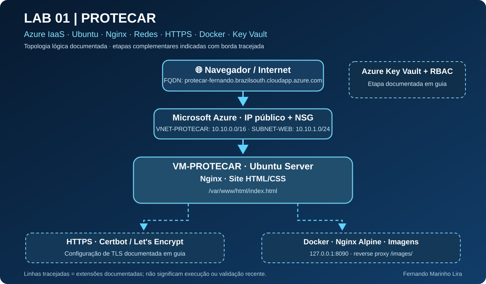

# ☁️ Laboratório Prático Microsoft Azure — Projeto ProteCar

**Portfólio técnico | Azure IaaS • Ubuntu Server • Nginx • Redes • DNS • HTTPS • Docker • Key Vault**

[](https://azure.microsoft.com/)


> **Escopo e transparência.** Esta documentação foi preparada a partir de três materiais técnicos anteriores do projeto. O portfólio base descreve uma página HTML/CSS publicada em uma VM Ubuntu com Nginx e DNS do Azure. Os guias complementares registram procedimentos de HTTPS/Certbot e Key Vault/Docker. **Checklists, exemplos de comandos e resultados esperados não são tratados como prova de execução atual.** Não há validação de disponibilidade do site ou de recursos Azure nesta publicação.

## 📑 Índice

1. [Objetivo e contexto](#1--objetivo-e-contexto)
2. [Topologia lógica do ProteCar](#2--topologia-lógica-do-protecar)
3. [Inventário dos recursos Azure documentados](#3--inventário-dos-recursos-azure-documentados)
4. [Etapas e documentos técnicos](#4--etapas-e-documentos-técnicos)
5. [Competências abordadas](#5--competências-abordadas)
6. [Matriz de evidências](#6--matriz-de-evidências)
7. [Organização dos arquivos](#7--organização-dos-arquivos)
8. [Pendências e boas práticas](#8--pendências-e-boas-práticas)
9. [Autor e referências](#9--autor-e-referências)

## 1. 🎯 Objetivo e contexto

O **ProteCar** é um laboratório prático de publicação de uma **página web estática** em infraestrutura **IaaS (Infrastructure as a Service)** no Microsoft Azure. O ambiente base utiliza **Ubuntu Server**, **Nginx**, **IP público**, **Network Security Group (NSG)** e um **FQDN do domínio `cloudapp.azure.com`**. O material original descreve a publicação do site e a possibilidade de acesso pela Internet. 

Os documentos complementares abrangem a configuração de **HTTPS com Certbot/Let's Encrypt**, o uso de **Docker + Nginx Alpine para servir imagens** e um fluxo de proteção de material sensível com **Azure Key Vault e RBAC**. A distinção entre **procedimento documentado** e **evidência anexada** está indicada nas seções seguintes.

## 2. 🗺️ Topologia lógica do ProteCar



[🔍 Abrir diagrama completo](./diagrams/topologia-protecar.svg)

**Fluxo de referência:** Navegador → FQDN configurado no IP público do Azure → NSG → interface de rede (NIC) da VM Ubuntu → Nginx principal → site estático. No guia de extensão, o Nginx faz reverse proxy de `/images/` para o container local `protecar-images` na porta `127.0.0.1:8090`.

> O diagrama apresenta **arquitetura lógica descrita nos documentos**, não um levantamento de implantação em tempo real. A utilização de HTTPS, Docker e Key Vault deve ser comprovada separadamente pelas evidências originais ou por testes posteriores.

## 3. 🧱 Inventário dos recursos Azure documentados

| Componente | Nome / configuração registrada | Função |
|---|---|---|
| Resource Group | `RG-AZ900-PROTECAR` | Organizar e administrar os recursos do laboratório |
| Rede virtual | `VNET-PROTECAR` — `10.10.0.0/16` | Endereçamento privado |
| Sub-rede | `SUBNET-WEB` — `10.10.1.0/24` | Rede da interface da VM |
| Máquina virtual | `VM-PROTECAR` — Ubuntu Server | Hospedar a aplicação e o Nginx |
| NIC | Interface da VM | Conectar a VM à sub-rede |
| IP público + rótulo DNS | `protecar-fernando.brazilsouth.cloudapp.azure.com` | Acesso por nome público |
| NSG | HTTP TCP 80; SSH TCP 22 conforme configuração documentada | Controle de tráfego |
| HTTPS (guia complementar) | TCP 443; Certbot/Let's Encrypt | Segurança TLS para o site |
| Docker (guia complementar) | `protecar-images`, `nginx:alpine`, `127.0.0.1:8090` | Entrega local de imagens |
| Key Vault (guia complementar) | Nome do cofre não confirmado | Armazenamento protegido de segredo/chave, conforme guia |

**Nota:** Não publicamos IP público numérico, credenciais, chave SSH, segredos, certificado privado nem inventamos nome de Key Vault. O FQDN é o identificador já presente na documentação original e **não indica que a URL esteja ativa hoje**.

## 4. ⚙️ Etapas e documentos técnicos

| Etapa | Escopo | Documento |
|---|---|---|
| **01 — Azure IaaS + Ubuntu + Nginx** | Provisionamento, rede, DNS, publicação HTML/CSS e administração Linux | [Abrir etapa 01](./docs/01-azure-iaas-nginx.md) |
| **02 — HTTPS e certificados** | Nginx, `server_name`, Certbot, Let's Encrypt, TLS e renovação | [Abrir etapa 02](./docs/02-https-certbot.md) |
| **03 — Docker e Key Vault** | Container de imagens, reverse proxy local, RBAC, gestão de segredos | [Abrir etapa 03](./docs/03-docker-keyvault.md) |
| **04 — Evidências e verificação** | Checklist de validação e registros faltantes | [Abrir matriz](./docs/04-evidencias.md) |

## 5. 🧠 Competências abordadas

- **Azure IaaS:** Resource Group, VM, virtual network, subnet, NIC, IP público e NSG.
- **Linux:** acesso remoto, administração de pacotes, `systemd`, arquivos e permissões.
- **Nginx:** entrega de conteúdo estático, server blocks, logs e análise de configuração.
- **DNS e segurança:** FQDN associado ao IP público, portas TCP 22/80/443 e certificados TLS.
- **Containers:** isolamento de serviço web auxiliar, bind mount somente leitura e acesso local.
- **Identity & Security:** conceitos de RBAC para acesso ao Key Vault e cuidados com segredos.
- **Troubleshooting:** diagnóstico de resolução DNS, portas, erros Nginx, acesso SSH e logs.

## 6. 🧪 Matriz de evidências

| Verificação | Evidência desejada | Situação de publicação |
|---|---|---|
| Inventário Azure | Captura do Resource Group / recursos sem dados sensíveis | Ainda não anexada |
| Site estático ProteCar | Captura da página e requisição HTTP | Descrito no portfólio de origem; captura não anexada aqui |
| Configuração Nginx | `nginx -t` + configuração anonimizada | Procedimento documentado; saída original não anexada |
| DNS público | Saída de consulta ao FQDN | Procedimento documentado; saída não anexada |
| Certificado HTTPS | Certificado público e teste de renovação | Guia disponível; evidência de execução não anexada |
| Docker local | `docker ps`, `curl` local e rota `/images/` | Guia disponível; evidência de execução não anexada |
| Key Vault / RBAC | Cofre, atribuição e segredo (sem conteúdo) | Guia disponível; evidência de execução não anexada |

## 7. 📂 Organização dos arquivos

```text
azure-labs/
├── README.md                       # índice de laboratórios
└── lab-01-protecar/
    ├── README.md
    ├── .gitignore
    ├── diagrams/
    │   └── topologia-protecar.svg
    ├── docs/
    │   ├── 01-azure-iaas-nginx.md
    │   ├── 02-https-certbot.md
    │   ├── 03-docker-keyvault.md
    │   └── 04-evidencias.md
    ├── evidencias/
    │   └── README.md
    └── configuracoes/
        └── README.md
```

## 8. 🔐 Pendências e boas práticas

1. Revisar e anexar **capturas reais**, comandos executados e respectivas saídas, com data e informações sensíveis ocultas.
2. Recuperar o **HTML/CSS original** do ProteCar antes de publicar arquivos web; nenhum código de aplicação foi inventado.
3. Revisar a exposição de **SSH TCP 22** e limitar origens administrativas quando apropriado.
4. Não publicar `.pem`, `.key`, chaves privadas de certificados, valores de segredos, senhas ou dados de clientes.
5. Registrar configurações **revisadas e anonimizadas** do Nginx, Docker e RBAC antes de apresentá-las como evidência de implantação.
6. Verificar situação atual dos recursos Azure e do FQDN sem presumir que ainda estejam ativos; qualquer novo teste deve ser datado.

## 9. 👤 Autor e referências

**Fernando Marinho Lira** — Infraestrutura de TI | Linux | Redes | Microsoft Azure  
**Certificação:** Microsoft Azure Fundamentals (AZ-900)

[GitHub](https://github.com/Fernando-Marinho-Lira) · [LinkedIn](https://www.linkedin.com/in/fernando-marinho-lira/)

**Materiais de origem consultados:**
- `Portfolio_Tecnico_Azure_ProteCar_Fernando_Marinho_Lira.docx` — publicação inicial em Azure IaaS.
- `Guia_Completo_Lets_Encrypt_Ubuntu_Nginx_ProteCar.pdf` — HTTPS/Certbot.
- `Guia_Completo_Lab_Azure_KeyVault_Docker_Nginx_ProteCar.docx` — segurança, Docker e integração Nginx.

*Os documentos originais não foram incorporados ao pacote público para evitar republicação acidental de dados sensíveis. Esta versão contém apenas documentação reorganizada e um diagrama ilustrativo.*